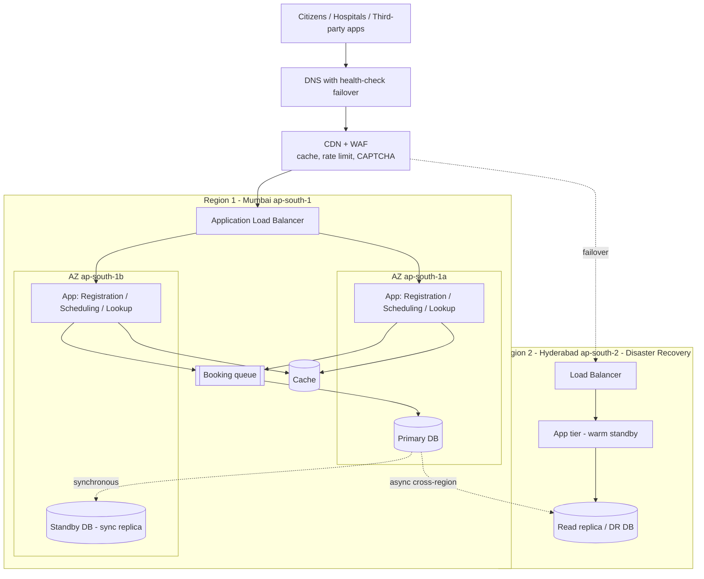
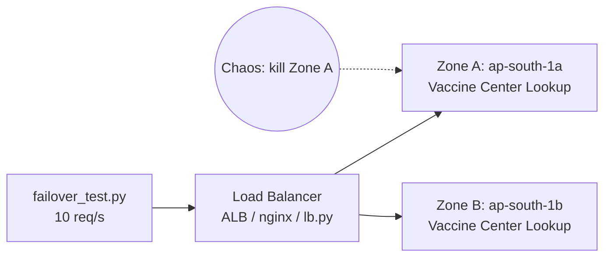

# CoWIN Multi-Zone / Multi-Region Architecture

## Reference design (Mermaid – renders on GitHub)

## What we actually built (PoC scope)

## Request flow
1. Citizen opens app → DNS returns the healthy region.
2. CDN/WAF serves cached slot data and throttles abusive clients.
3. Load balancer sends the request to a healthy app node in either AZ.
4. Reads hit the cache; booking writes go via a queue to the primary database.
5. Database replicates synchronously to the standby AZ and asynchronously to the DR region.
6. If a node/AZ fails, health checks remove it; if a region fails, DNS fails over to Region 2.

## Failure scenarios
| Failure | Detection | Result |
|---|---|---|
| App node crash | LB health check | Traffic goes to the other AZ (demonstrated in our PoC) |
| Entire AZ outage | LB health check | Other AZ serves; DB standby promoted |
| Whole region outage | DNS health check | Failover to Hyderabad (warm standby) |
| Traffic spike | CPU/request metrics | Auto Scaling adds nodes; CDN/cache absorbs reads |

*Export the first diagram to PNG/SVG (https://mermaid.live) for the report and slides.*
